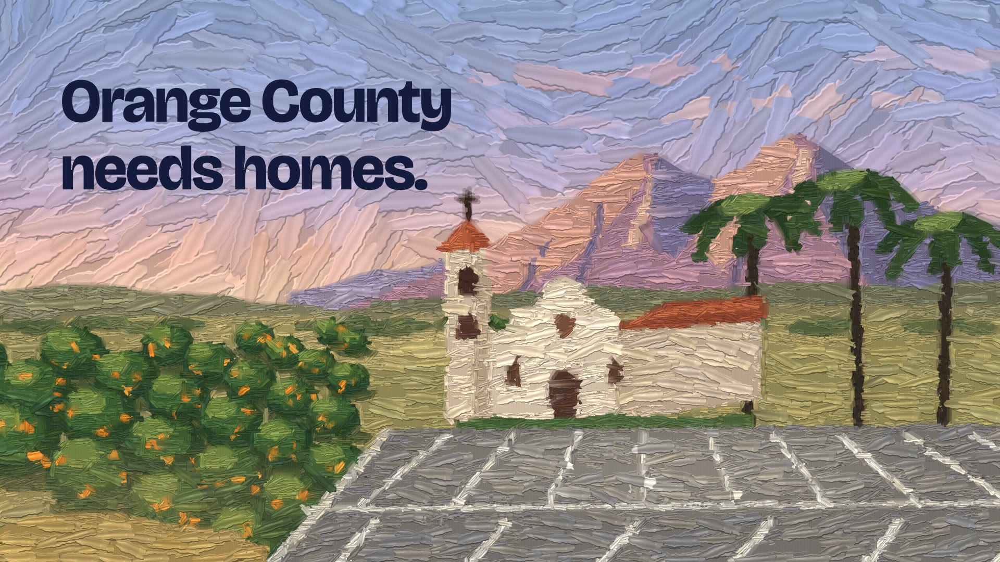

<p align="center">
  
</p>

<p align="center">
  <b>Find the land California's new housing laws opened, without a GIS team.</b><br>
  Every parcel in Santa Ana, sifted one legal test at a time. Every cut cites its data.
</p>

<p align="center">
  <a href="#run-it">Run it</a> ·
  <a href="#how-it-works">How it works</a> ·
  <a href="#architecture">Architecture</a> ·
  <a href="#data">Data</a> ·
  <a href="#what-to-trust">What to trust</a>
</p>

---

## The problem

Small housing nonprofits find land by luck: a city calls about surplus land, or a church offers its parking lot. Meanwhile California has passed laws that open land that used to be off-limits: church and college land (SB 4), lot splits (SB 9), small-lot subdivisions (SB 684 / SB 1123), commercial corridors (AB 2011), and public land that agencies must offer to affordable builders first (Surplus Land Act).

The laws are public. The parcel data is public. But answering "can we build here?" for one parcel means stacking five to eight map layers, and nobody can do that for 58,000 parcels by hand.

Groundwork does it for the whole city, shows its work, and ends every screen in something a one-person acquisitions team can do today.

> Built for Lane 1, **Find it**, at the Claude Impact Lab (UC Irvine, Nov 2026). A prototype for screening, not legal, financial or lending advice.

## How it works

<p align="center">
  
</p>

**1. Say what you're looking for, in plain words.** Pick a lens like *Church & college land*, or type "that dead Kmart on 17th with the giant empty lot". Claude reads the request into a lens and filters, and you see what it understood (and how many lots match) before you press Enter.

**2. Watch the city get sifted.** All 57,926 parcels start on the map. Each legal or physical test runs in turn; parcels that fail fall away in a wave, and a receipt writes itself: how many each test removed, under which statute page, from which dataset. Tests no public data can answer never remove anything. They stay on every lot as an open question.

**3. Work the shortlist.** Survivors are ranked by a transparent score (every point is listed on the site page). Save, pass with a reason, or filter by transit, open land and minimum homes. Print a one-page board brief of your saved lots.

**4. Open a lot.** A verdict in plain words, an estimate of homes (labeled as an assumption), every check grouped into *didn't pass*, *passed* and *no public data can answer these yet*, each with its dataset, link and date. Then a next step and a first letter to the owner, drafted by Claude and never sent.

**5. Research what no map knows.** Some questions have no public layer: who owns the land, whether the city exempted the parcel, whether a building is on a register. Press *Research* and Claude searches public records for that lot while you watch, then puts each finding under its question: *sources suggest yes*, *no*, or *still unclear*, with a confidence level and links. Findings are evidence to verify, never a pass, and they're saved, so the next person who opens the lot sees them instantly.

**Already have a lot in mind?** Search any address or APN and see how all five laws apply to it.

### The five lenses

| Lens, in plain words | Law | What we check | What stays a question |
|---|---|---|---|
| Church & college land | SB 4 · Gov Code 65913.16 | Place of worship mapped, fire, flood, fault zone, wetland, heavy industry within 1,200 ft, 75% urban edge, conservation easement; flags contamination and industrial neighbors | Ownership since Jan 1, 2024; Title V and refinery distances; protected habitat |
| Public land for sale | Surplus Land Act · Gov Code 54220+ | Notice of Availability on file, response window; flags contamination | Surplus vs. exempt surplus |
| Underused commercial lots | AB 2011 · Gov Code 65912.100+ | Office/retail/parking zoning, room to build, size; flags wetland, fault, contamination, industrial neighbors, historic | Whether the city exempted the parcel |
| Room for 10 starter homes | SB 684 / SB 1123 · Gov Code 66499.41 | Multifamily or vacant single-family zoning, lot-size cap, fire, fault, wetland, farmland; flags urban surroundings | Tenants in the last 5 years |
| Big backyards | SB 9 · Gov Code 65852.21, 66411.7 | Single-family zoning, splittable lot, fire, flood, fault, wetland; flags historic registers and districts | Rented in the last 3 years, rent control |

Checks backed by direct evidence can remove a parcel. Proxies only *flag* it: being inside a historic district doesn't prove a building contributes, and an industrially zoned neighbor isn't proof of industrial use. Across the five laws, 8 questions remain that no public data answers; those are what the research agent is for.

Every rule, threshold and page citation is in [`docs/rules.md`](docs/rules.md), researched from HCD's fact sheets (April 2026) and marked where a source was secondary or a fact unverified.

## Architecture

<p align="center">
  
</p>

```
public sources ──▶ scripts/data (cached, run once) ──▶ public/data/santa-ana/*.json
                                                            │
                                     src/lib/rules  ◀───────┘   lenses: pool → law → practical → unknown
                                            │
                    src/components (Next.js app) ──▶ deck.gl map · sheet · search · site page
                                            │
               /api/ask · /api/draft · /api/research  ──▶  Claude (+ web search)
                                            │
                              lib/server/researchStore  ──▶  data/research/*.json  or  Upstash Redis
```

- **Pipeline** (`scripts/data/`): fetches 26 public sources once, caches every response under `data/raw/`, and builds a columnar file of every parcel (centroid, lot area, zone category, a 23-bit flag mask) plus detail records for 5,645 candidate sites. Enrichment adds fault zones, historic registers and districts, open contamination cases, wetlands, farmland, protected land, freeways, distance to heavy-industrial zoning, and how much of each site's edge borders developed land (sampled every 5 m). Spatial joins are point-in-polygon on parcel centroids.
- **Rules engine** (`src/lib/rules/`): each lens is an ordered list of steps (`pool`, `law`, `practical`, `flag`, `unknown`), each with its citation and source. The same steps run over 57,926 parcels for the sieve and over one parcel for the site page. No hidden logic.
- **App** (`src/components/`): Next.js 16 and React 19. The map is deck.gl over a muted MapLibre basemap, painted by a small controller outside React that animates 58k points on the GPU only while something moves.
- **Claude** (`src/app/api/`): `claude-opus-5-5` turns plain-language search into a lens and filters (structured output), drafts owner letters from facts the app supplies (streamed), and researches a lot's open questions with server-side web search and fetch. Research runs in two passes: Claude researches freely, then a second call turns its notes into one finding per question, and any source URL it didn't actually see is dropped. It never reports private individuals, only institutions. Without an API key, search and letters fall back to keyword matching and a template.
- **Saved research** (`src/lib/server/researchStore.ts`): every research run is saved per lot and law, and anyone who opens the lot later gets it back instantly. JSON files in `data/research/` by default; Upstash Redis when deployed (serverless filesystems don't keep writes).
- **Design** (`DESIGN.md`): two inks on white stock, Bricolage Grotesque, Inter Tight and Geist Mono. The README animations are authored with Clayzo from the same tokens (`clayzo/readme/`).

```
src/
  app/            page, API routes (ask, draft, research), error page, /brand design board
  components/     App shell, CityMap, Home, Sieve, Shortlist, SiteDetail, Search, LogoMark, LensIcon
  lib/
    rules/        lenses.ts (the five pathways), engine.ts (sieve + evaluate), cites.ts
    data.ts       loading + normalization        query.ts   plain-language reading
    score.ts      transparent ranking            mapController.ts   per-frame map painting
    server/       researchStore.ts (saved research: files or Upstash)
scripts/
  data/           the pipeline (own package.json)
  check/          render-all.tsx, renders every screen for every lot
data/research/    saved web research, one file per lot
docs/rules.md     the law, page by page
```

## Data

Twenty-six public sources, each fetched once on Nov 7, 2026 and cached. Each check in the app links to its source and shows the date. The full registry, with record counts and notes, is in `public/data/santa-ana/sources.json`.

| Source | Used for | Records |
|---|---|---|
| [Santa Ana Assessor Parcels](https://gis.santa-ana.org/server/rest/services/Public/GIS_AssessorParcels/MapServer/0) | Parcel universe, addresses, land and building values | 57,926 |
| [Santa Ana Zoning](https://gis.santa-ana.org/server/rest/services/Public/PBA_ZoningClassifications/FeatureServer/0) | Local zoning per parcel | 3,192 |
| [SCAG Zoning, Existing Land Use, General Plan](https://maps.scag.ca.gov/scaggis/rest/services/LDX) | Zone category fallback, vacancy, religious facilities | 42,896 each |
| [HCD Surplus Land Act notices](https://data.ca.gov/dataset/surplus-land-act-notices-of-availability-received) | Public land offered to affordable builders | 91 in Santa Ana |
| [OpenStreetMap places of worship](https://wiki.openstreetmap.org/wiki/Tag:amenity%3Dplace_of_worship) | Church and college land (proxy) | 85 |
| [OC Floodplains (FEMA DFIRM)](https://www.ocgis.com/arcpub/rest/services/Map_Layers/Floodplains/MapServer/0) | Special flood hazard areas | 58 |
| [OC and CAL FIRE hazard severity zones](https://services.gis.ca.gov/arcgis/rest/services/Environment/Fire_Severity_Zones/MapServer) | Very high fire zones (none in Santa Ana) | 0 |
| [CGS liquefaction and landslide zones](https://www.ocgis.com/arcpub/rest/services/Map_Layers/Liquefaction/MapServer/0) | Ground risk, as context | 5 / 0 |
| [Caltrans High Quality Transit Areas](https://caltrans-gis.dot.ca.gov/arcgis/rest/services/CHrailroad/CA_HQ_Transit_Areas/FeatureServer/0) | Parking waivers (proxy) | 239 |
| [CalEnviroScreen 5.0](https://services1.arcgis.com/PCHfdHz4GlDNAhBb/arcgis/rest/services/calenviroscreen50results_F_070126_gdb/FeatureServer/2) | Pollution burden, as context | 95 tracts |
| [OC Building Footprints](https://www.ocgis.com/arcpub/rest/services/Map_Layers/Building_Footprints/MapServer/0) | How much of each lot is built | 82,550 |
| [CGS Alquist-Priolo Fault Zones](https://services2.arcgis.com/zr3KAIbsRSUyARHG/arcgis/rest/services/CGS_Alquist_Priolo_Fault_Zones/FeatureServer/0) | Earthquake fault zones (none touch Santa Ana) | 0 |
| [Santa Ana historic properties and districts](https://gis.santa-ana.org/server/rest/services/Public/PBA_HistoricResource/FeatureServer) | Santa Ana Register, local historic districts | 728 / 5 |
| [National Register of Historic Places (NPS)](https://mapservices.nps.gov/arcgis/rest/services/cultural_resources/nrhp_locations/MapServer) | National Register properties and districts | 22 / 4 |
| [DTSC EnviroStor](https://services3.arcgis.com/Oy2JTCD10wkoelxS/arcgis/rest/services/Envirostor_Public_Data_Export/FeatureServer/0) | Open contamination cases | 205 in area |
| [USFWS National Wetlands Inventory](https://fwspublicservices.wim.usgs.gov/wetlandsmapservice/rest/services/Wetlands/MapServer/0) | Mapped wetlands | 119 |
| [CA Important Farmland (FMMP 2022)](https://gis.conservation.ca.gov/server/rest/services/DLRP/CaliforniaImportantFarmland_2022/FeatureServer/0) | Farmland (none on a Santa Ana parcel) | 8 |
| [CPAD](https://services1.arcgis.com/4ZKi1B1zTblbwgWB/arcgis/rest/services/CPAD_Holdings_Current_Release/FeatureServer/0) and [CCED](https://gis.cnra.ca.gov/arcgis/rest/services/Boundaries/CCED_AccessType/MapServer/0) | Protected open space; conservation easements (none in Santa Ana) | 181 / 0 |
| [Caltrans State Highway Network](https://caltrans-gis.dot.ca.gov/arcgis/rest/services/CHhighway/SHN_Odometer/FeatureServer/0) | Freeways within 500 ft (AB 2243) | 24 lines |

Three sources couldn't be used and are marked failed: SCAG's housing-element sites (no Santa Ana records), GeoTracker (no official public map service), and the California Register (not published as map data). Heavy-industry distance, industrial neighbors and the urban-edge share are derived from the data above; their methods are in `scripts/data/README.md`. Full notes, field mappings and every assumption: [`scripts/data/README.md`](scripts/data/README.md).

Map data © [OpenStreetMap](https://www.openstreetmap.org/copyright) contributors (ODbL); basemap by [OpenFreeMap](https://openfreemap.org).

## What to trust

Groundwork follows the event's ground rules: no invented facts, every assumption labeled, unknown is an answer.

**Real:** every parcel, zone, hazard and notice comes from the public sources above. Every legal threshold comes from HCD fact sheets with page numbers.

**Proxies, flagged as proxies in the app:** heavy industry = M2 zoning within 1,200 ft; industrial neighbor = M1/M2 zoning within 15 ft; historic = on a register or inside a district; contamination = an open EnviroStor case on or within 50 ft of the lot; urban edge = neighbors' land use sampled along the boundary, across streets.

**Web research is evidence, not an answer.** Each finding shows its sources and confidence, and the check it relates to stays marked unknown.

**Assumed, and labeled as assumed in the app:**
- Home counts use density minimums from the fact sheets (SB 4's 30 homes per acre assumes Santa Ana is in a metropolitan county, which is unverified).
- "Practical" filters (minimum lot size, room to build) are our judgment, tagged *our call*.
- The ranking score's weights are ours, and every point is itemized.

**Where it's wrong, or can't know:**
- **Ownership.** No free data says who owns a parcel. A mapped church is a lead, not proof the congregation owns the land; the research agent can often find the institution, but that's still web evidence to verify.
- **Tenancy, historic status, rent control.** These kill many SB 9 sites and no public layer covers them. They stay as questions.
- **Spatial joins** use parcel centroids, so a lot straddling a flood line can land on either side.
- **Surplus notices.** Every Santa Ana notice is archived as of the data date; the app shows the closed window instead of hiding the lot.
- **Santa Ana only.** The pipeline takes a city config; other cities need their layers wired up.

## Run it

```bash
npm install
npm run dev
```

Open http://localhost:3000. The parcel data is already built and committed in `public/data/`.

Optional keys go in `.env.local` (see [`.env.example`](.env.example)):

```bash
cp .env.example .env.local
```

- `ANTHROPIC_API_KEY` turns on Claude: plain-language search, letter drafts and lot research. Without it, search uses keyword matching and letters use a template.
- `UPSTASH_REDIS_REST_URL` and `UPSTASH_REDIS_REST_TOKEN` store saved research in Redis. Set them when deploying; locally, research saves to `data/research/`.

Check that every screen renders for every lot under every law (about 29,000 views, ~15 s):

```bash
npm run check
```

Rebuild the data from cache, or fetch it fresh:

```bash
cd scripts/data && npm install && cd ../.. && node scripts/data/build.mjs santa-ana --no-fetch
```

## Built with

Next.js 16 · React 19 · deck.gl · MapLibre · Motion · Zustand · Tailwind CSS 4 · Claude (`claude-opus-5-5`, with server-side web search) · Upstash Redis (optional) · Clayzo for the README animations.

## Demo video

<p align="center">
  <a href="https://youtu.be/aTXkrO2AlLs"></a><br>
  <sub><a href="https://youtu.be/aTXkrO2AlLs"><b>Watch the 30-second demo on YouTube</b></a>. Built with Clayzo in <a href="clayzo/demo/"><code>clayzo/demo/</code></a>; its numbers are from the SB 4 rules as of Nov 7, before the lens gained its newer checks.</sub>
</p>

---

<p align="center"><sub>Prototype. Not legal, financial or lending advice. Nothing here files an application, emails a city, or contacts an owner.</sub></p>
